# Preset library

Remotion + TypeScript, MIT. Every easing comes from [`src/curves.ts`](src/curves.ts) (named cubic-beziers incl. AE "easy ease", overshoot, anticipation, snap) and `sample(track, frame)` animates ANY numeric property from keyframes.

Stills are generated by `npm run stills`. Text and mockup stills are 4-frame strips (left → right = time).

## Text (32) — `<TextFx preset="id" text="Plain *hot words*" />`

- **fadeUp** — opacity + 0.25em rise 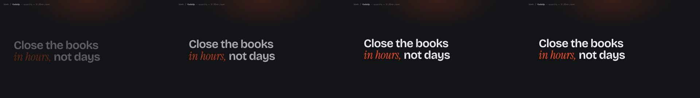
- **wordRise** — per-word rise, 3f stagger 
- **letterRise** — per-letter rise, 1f stagger 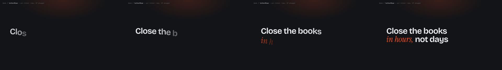
- **blurInWord** — per-word 14px blur → sharp 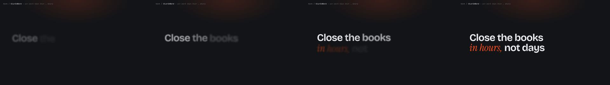
- **blurInLine** — per-line 20px blur + 6% scale settle 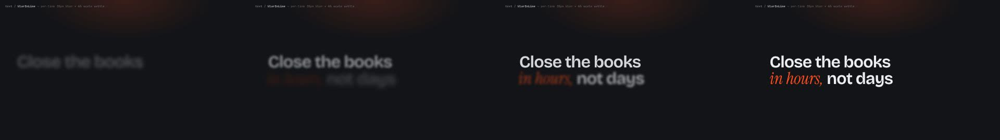
- **maskWipeLR** — clip wipe left→right 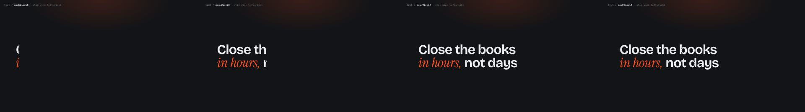
- **maskWipeUp** — words slide up inside mask 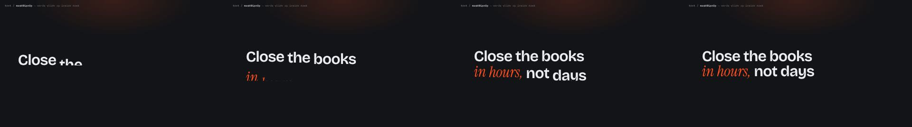
- **lineMaskRise** — editorial masked line rise with 4° tilt 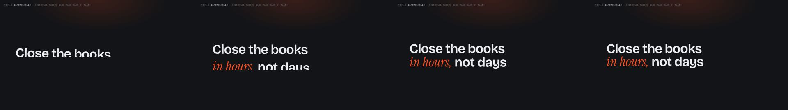
- **trackingIn** — letter-spacing 0.42em → -0.02em 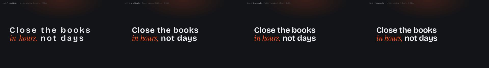
- **trackingOut** — crushed → open tracking with blur 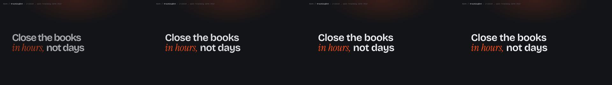
- **weightMorph** — variable wght 200 → 800, per letter 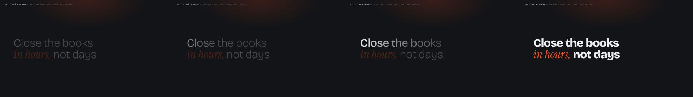
- **weightPunchHot** — hot word wght 500 → 820 + 8% bump 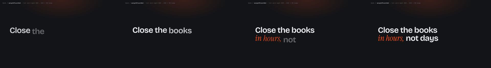
- **scalePunchHot** — hot word scale 1 → 1.18 → 1 in 10f 
- **scaleIn** — scale 0.82 → 1 overshoot 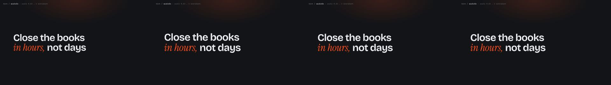
- **dropIn** — words drop from above, overshoot 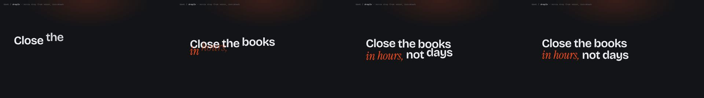
- **slotRoll** — odometer roll per letter 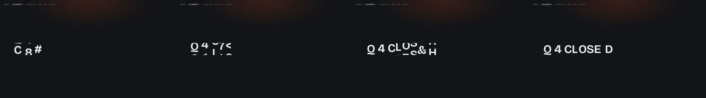
- **scramble** — random glyphs resolve left → right 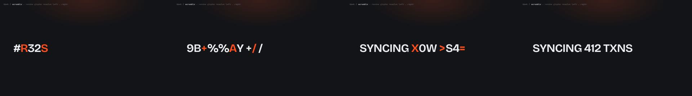
- **typewriter** — 1 char / 1.4f with blinking caret 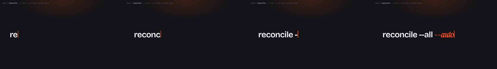
- **typeCaretSnap** — word-at-a-time typing, block caret 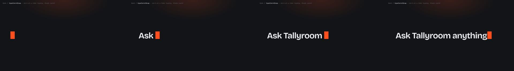
- **splitCenter** — clip opens from centre 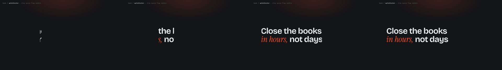
- **rotateXFlip** — per-word rotateX 92° → 0 
- **skewSlide** — skewX -14° + slide 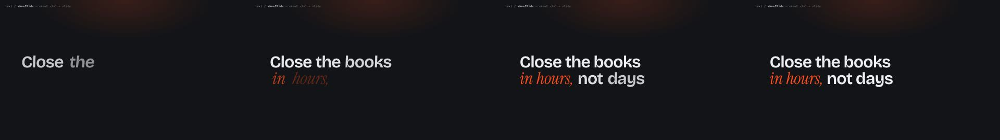
- **glitchIn** — 9f RGB split + slice jitter, then clean 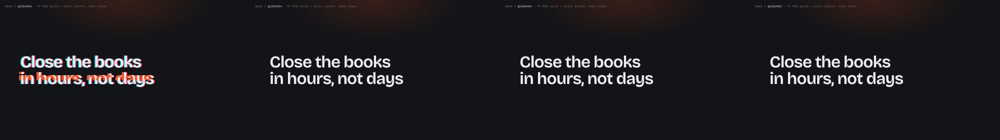
- **gradientSweep** — gradient fill travels once across 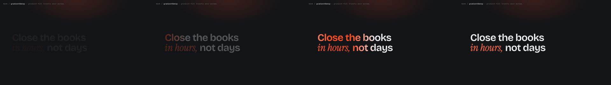
- **shineSweep** — specular band crosses the text 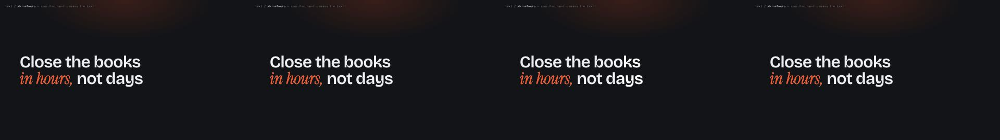
- **strikeReplace** — markup "old|new": strike, swap 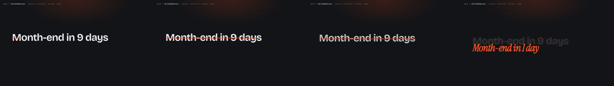
- **highlightMarker** — accent block wipes behind hot word 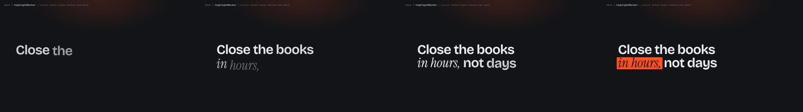
- **underlineDraw** — underline draws under hot word 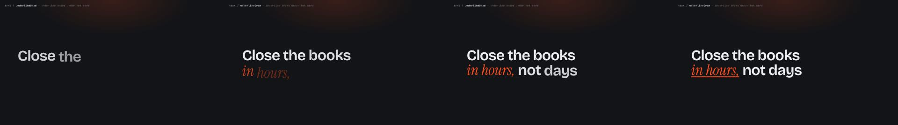
- **counterUp** — first number counts up from 0 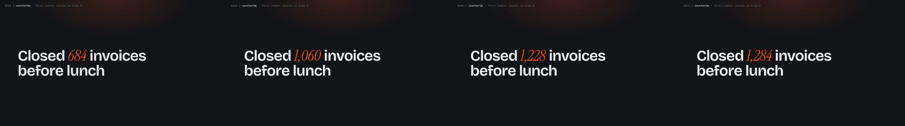
- **stackPush** — lines stack, older lines dim to 35% 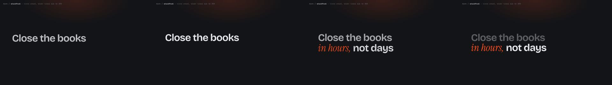
- **focusPull** — others blur 5px + dim, hot word stays sharp 
- **exitBlurDown** — exit: blur 12px, drop, fade (12f) 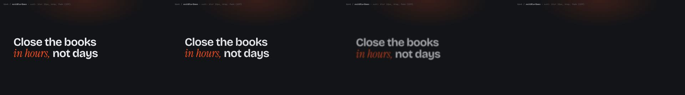

## Mockup moves (21) — `<MockupMove move="id" p={palette} />`

- **landView** — rotateX 28→0, rotateY -18→0, scale .9→1, 40f easeOutExpo 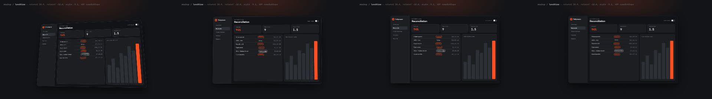
- **tiltIdle** — idle drift rotateY ±3°, rotateX 6±1°, 120f sine 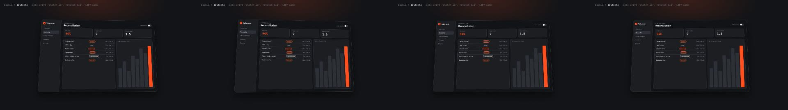
- **cameraPush** — dolly scale 1→1.35 toward the KPI cards, 90f easeInOut 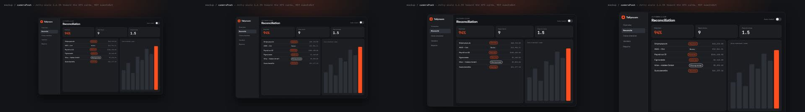
- **cameraPan** — pan table → chart, 50f easeInOutExpo, at 1.3x 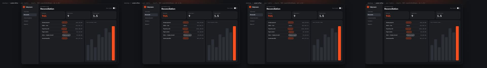
- **pushAndSettle** — scale 1→1.12 then settle 1.08, 24f overshoot 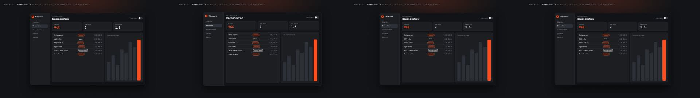
- **cardFan** — 3 cards fan rot -14/0/+14°, x ±70, 24f stagger 4 overshoot 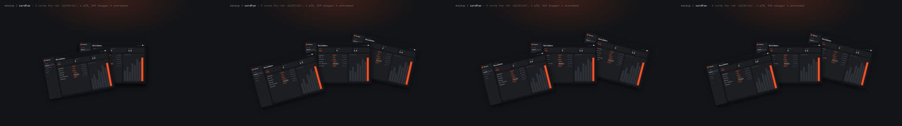
- **cardStack3D** — cards stacked z 0/-80/-160 spread to -0/-260/-520 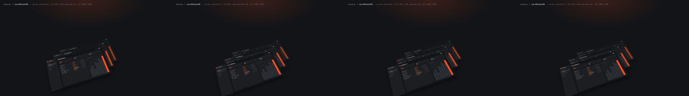
- **depthLayers** — parallax: bg 0.4x, ui 1x, chips 1.6x of camera move 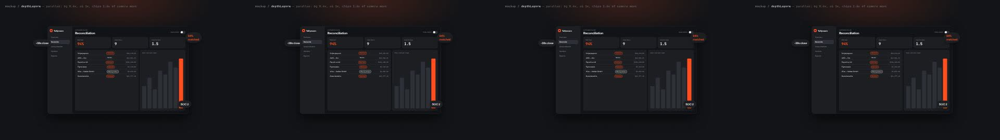
- **parallaxDrift** — ui and chips drift in opposite directions ±16px/s 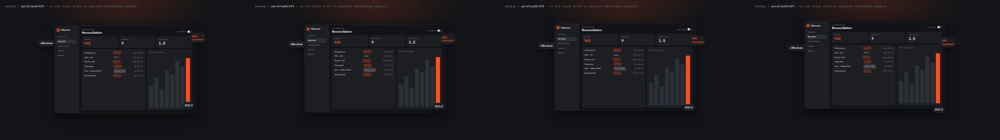
- **cursorMove** — cursor on an arced bezier path, 30f easeInOut, 12% arc 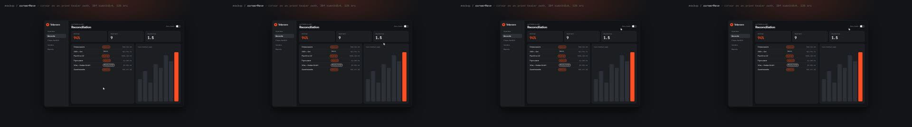
- **cursorClick** — press scale .85 over 8f + ring ripple 16f; UI reacts 4f later 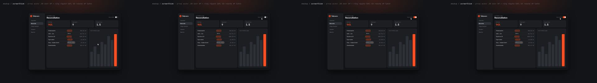
- **cursorHesitate** — decelerates hard near target, 3% overshoot then settles 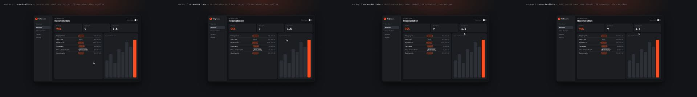
- **uiBuild** — UI builds itself: elements pop stagger 3f, y 18→0 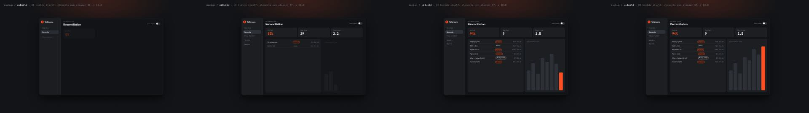
- **rowCascade** — table rows reveal top→bottom stagger 2f 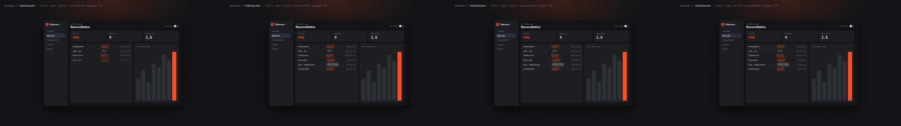
- **chartGrow** — bars grow 26f easeOutExpo stagger 3f 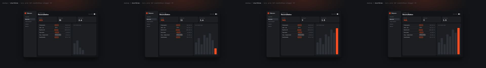
- **toggleFlip** — switch flips 8f overshoot 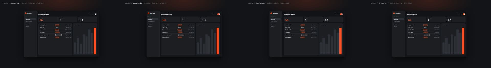
- **notificationDrop** — toast drops from top 18f overshoot 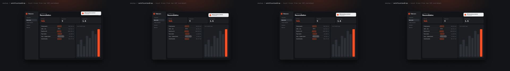
- **floatingLabels** — callout chips pop (overshoot) then bob ±6px 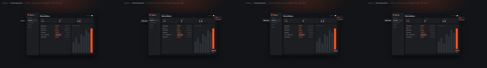
- **zoomHighlight** — spotlight dims 55% except one region, 14f 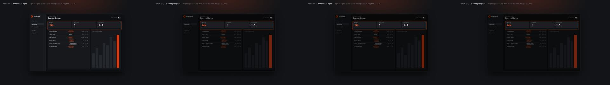
- **motionBlurTrail** — whip-in from right, blur = 0.04 · px/frame 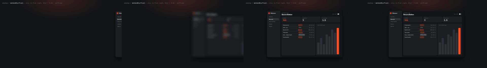
- **deviceSwap** — rotateY 0→180 reveals second screen, 30f easeInOutExpo 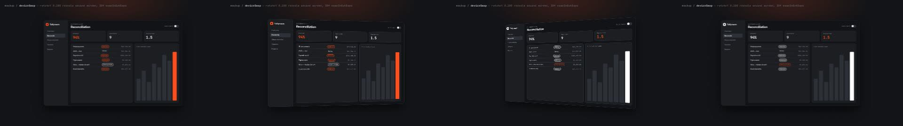

## Liquid glass (8) — `<GlassPanel variant="id" behind={bg} ... />`

| | |
|---|---|
| **clear** — Apple-like clear lens; busy bg only |  |
| **frosted** — readable cards over imagery | 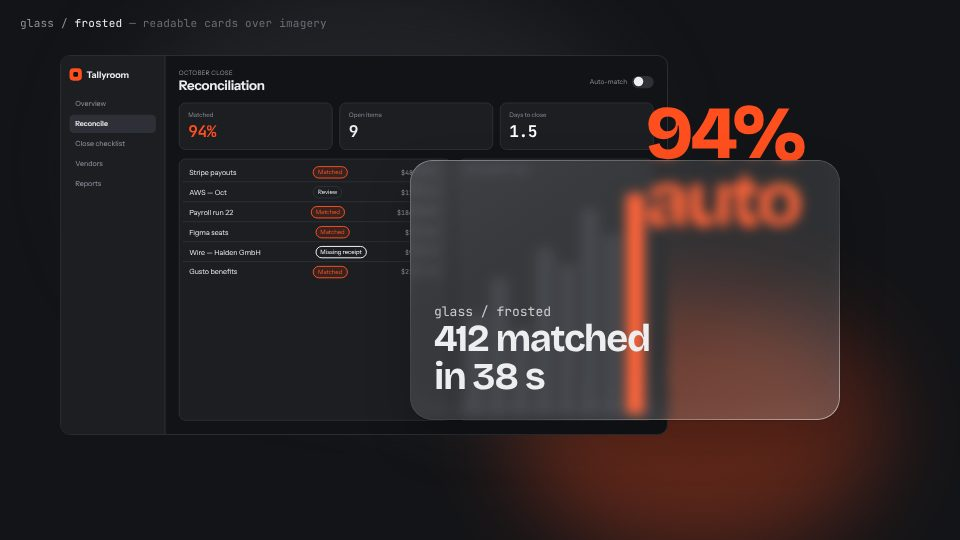 |
| **tinted** — brand-tinted CTA panel |  |
| **smoke** — dark glass for white text |  |
| **thickLens** — heavy lensing, hero moments only |  |
| **pill** — capsule (tab bar / button) |  |
| **prism** — strong chromatic fringe; sparingly |  |
| **milk** — legibility first, body text OK |  |

## Backgrounds + palettes (12) — `<Background bg="id" paletteId="id" />`

Contrast numbers: [PALETTES.md](PALETTES.md).

| | |
|---|---|
| **inkGrid** — gridVignette + inkCitrus |  |
| **paperEditorial** — paperGrain + paperCobalt |  |
| **tealTopo** — topo + nightTeal |  |
| **plumMesh** — meshDrift + bonePlum |  |
| **graphiteSpot** — spotlight + graphiteSignal |  |
| **navyConic** — conicSweep + primaryBRY |  |
| **mintDots** — dotMatrix + mintSlate |  |
| **roseAurora** — aurora + duskRose |  |
| **forestHalftone** — halftone + sandForest |  |
| **voidRibbon** — ribbon + electricVoid |  |
| **tomatoBlobs** — blobs + creamTomato |  |
| **steelScan** — scanlines + iceSteel |  |
